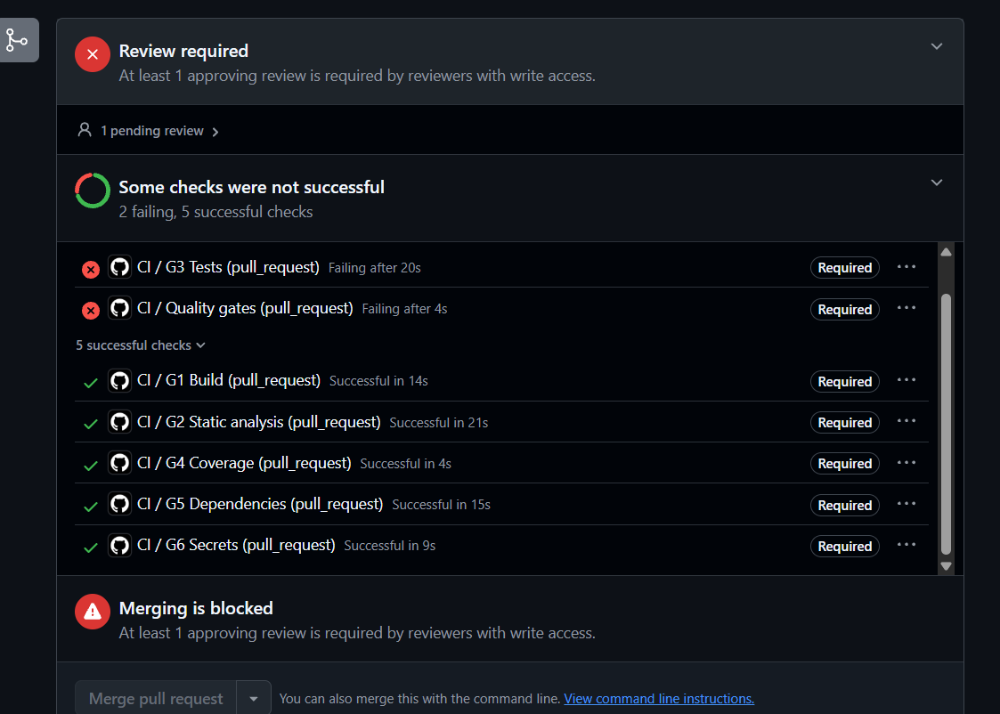

# Experimento — aprovado, reprovado, corrigido

Entrega E4. Atende à seção 7 do [enunciado](enunciado.pdf). Os riscos estão no [PLANO.md](PLANO.md), os testes em [testes.md](testes.md) e os gates em [gates.md](gates.md). Horários de Brasília, 23/11/2026.

## Hipótese e alteração

**Pergunta:** se alguém quebrar a moderação de depoimentos, o pipeline percebe e impede o merge?

**Alteração controlada:** remover uma linha de `TestimonialService::getPaginated()`, o filtro que mantém só os depoimentos aprovados (risco R1).

```diff
         return Testimonial::query()
-            ->where(Testimonial::IS_APPROVED, true)
             ->orderBy(Testimonial::ID, 'desc')
```

Foi escolhida por atingir a funcionalidade central e por ser um defeito que só um teste de comportamento percebe: o código continua válido, no padrão e sem erro de tipo.

**Previsão, feita antes do run:** reprova só o G3. O G4 deveria cair de 101/112 para 100/111 linhas no `TestimonialService` (90,09%) e continuar acima do limite de 90%. Ela se confirmou.

## Os três runs

| | 1. Aprovado | 2. Reprovado | 3. Corrigido |
|---|---|---|---|
| Run | [45243705351](https://github.com/carloseduardorocha/bicho-do-mato-qaops/actions/runs/45243705351) | [45247878043](https://github.com/carloseduardorocha/bicho-do-mato-qaops/actions/runs/45247878043) | [45250612311](https://github.com/carloseduardorocha/bicho-do-mato-qaops/actions/runs/45250612311) |
| Gatilho | push na `main` | pull request [#7](https://github.com/carloseduardorocha/bicho-do-mato-qaops/pull/7) | pull request [#7](https://github.com/carloseduardorocha/bicho-do-mato-qaops/pull/7) |
| Commit | `e0b4cd8` | `79548cc` (remove o filtro) | `de93873` (devolve o filtro) |
| Início | 15:56:47 | 16:20:18 | 16:35:59 |
| Duração do run | 40 s | 36 s | 49 s |
| G1 Build | ✅ 15 s | ✅ 14 s | ✅ 15 s |
| G2 Análise estática | ✅ 16 s | ✅ 21 s | ✅ 19 s |
| G3 Testes | ✅ 18 s | ❌ 20 s | ✅ 22 s |
| G4 Cobertura | ✅ 8 s | ✅ 4 s | ✅ 10 s |
| G5 Dependências | ✅ 16 s | ✅ 15 s | ✅ 13 s |
| G6 Segredos | ✅ 18 s | ✅ 9 s | ✅ 10 s |
| Quality gates (resumo) | ✅ 4 s | ❌ 4 s | ✅ 6 s |
| Testes | 133 aprovados | **6 reprovados**, 127 aprovados | 133 aprovados |
| Resultado | Aprovado | **Merge bloqueado** | Aprovado |

A duração vai do início do run ao fim do último job. G1, G2, G3, G5 e G6 rodam em paralelo, por isso o total é menor que a soma. Com um run de cada, a diferença entre 36 s e 49 s é variação do ambiente, e não efeito da alteração.

## Onde e por que falhou

**Onde:** no job `G3 Tests` ([log](https://github.com/carloseduardorocha/bicho-do-mato-qaops/actions/runs/45247878043/job/137949344791)). O `Quality gates` reprova junto porque resume os outros.

**Por quê:** sem o filtro, a lista pública devolve também os pendentes. Os 6 testes que reprovaram são todos de R1:

| Teste | Tipo | O que acusou |
|---|---|---|
| `TestimonialServiceTest::test_paginated_list_returns_only_approved_testimonials_newest_first` | Unitário | A lista trouxe um pendente |
| `TestimonialServiceTest::test_paginated_list_respects_the_page_size_and_counts_only_approved` | Unitário | Contou 5 em vez de 3 |
| `TestimonialModerationTest::test_testimonial_sent_by_the_public_appears_only_after_approval` | Feature | O depoimento apareceu antes da aprovação |
| `TestimonialModerationTest::test_admin_list_shows_only_approved_testimonials` | Feature | O pendente apareceu na lista de aprovados do admin |
| `TestimonialVisibilityTest::test_public_page_hides_pending_testimonials` (`/depoimentos`) | Feature | O pendente apareceu na página |
| `TestimonialVisibilityTest::test_public_page_hides_pending_testimonials` (home) | Feature | O pendente apareceu na home |

Trecho do log:

```
Tests:    6 failed, 127 passed (408 assertions)
FAILED  Tests\Unit\Services\TestimonialServiceTest > paginated list respe…
Failed asserting that 5 is identical to 3.
at tests/Unit/Services/TestimonialServiceTest.php:56
##[error]6 of 133 tests failed. Details in the 'Run tests' step and the g3-tests-junit artifact.
##[error]At least one gate failed. Merge into main is blocked. See the table in the run summary.
```

**Por que os outros gates não acusaram:** G1 e G2 verificam se o código sobe e está bem escrito, e ele está. O G4 mede linhas executadas, e todas as de `getPaginated()` continuam executadas. G5 e G6 olham dependências e segredos. É por isso que o G3 existe: só ele verifica o comportamento.

## Como o feedback apareceu

| Onde | O que mostrou |
|---|---|
| Check no PR | `G3 Tests` e `Quality gates` em vermelho, os outros 5 em verde, todos *Required*, e "Merging is blocked" |
| Anotações | Uma por teste reprovado, com o nome do teste, o arquivo e a linha (ex.: `tests/Unit/Services/TestimonialServiceTest.php:30`) |
| Resumo do run | Tabela dos gates com o G3 reprovado e a lista dos testes que falharam |
| Log | Valor esperado e obtido de cada teste |
| Artifacts | `g3-tests-junit` (relatório JUnit) e `g4-coverage-report`, preservados mesmo com a falha |

O G3 terminou 23 s depois do início do run, e o resultado final saiu aos 36 s.



**Sobre o bloqueio:** no run reprovado havia dois impedimentos ao mesmo tempo: os checks obrigatórios em vermelho e a aprovação do outro integrante, ainda pendente. A caixa do GitHub cita só o segundo, mas cada check marcado como *Required* também impede o merge. Depois da correção, restou só a aprovação.

## Correção

O commit `de93873` devolve a linha, e o código de `app/` volta a ser idêntico ao da `main`. O PR é mergeado com *merge commit* para o histórico guardar a falha e a correção.

## Limitações

- É um defeito só, em um gate só. O G2 e o G5 também já reprovaram em runs reais ([PR #5](https://github.com/carloseduardorocha/bicho-do-mato-qaops/pull/5) e [PR #4](https://github.com/carloseduardorocha/bicho-do-mato-qaops/pull/4)). G1, G4 e G6 não têm reprovação registrada no GitHub.
- O defeito foi escolhido sabendo que havia testes para ele. Um defeito fora de R1 a R4 pode passar (ver "O que ficou de fora" em [testes.md](testes.md)).
- Logs e artifacts do GitHub Actions expiram. Por isso o trecho do log e a imagem estão aqui.
