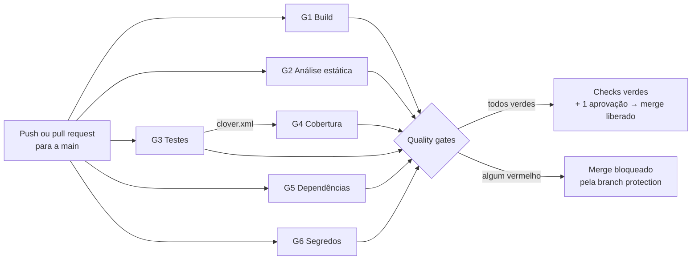

# 1. Identificação

| Campo | Registro |
|----|----------|
| Integrantes | Carlos Rocha (`carloseduardorocha`) e Renato Piovesan (`renatopiovesan`) |
| Disciplina | Qualidade de Software, Sistemas de Informação, UFSM |
| Sistema | Site da ONG Bicho do Mato (páginas públicas e área administrativa) |
| Repositório | <https://github.com/carloseduardorocha/bicho-do-mato-qaops> (público) |
| Plataforma | GitHub Actions, com *branch protection* na `main` |
| Versão analisada | `main` em `afd12f4`, run [45305184824](https://github.com/carloseduardorocha/bicho-do-mato-qaops/actions/runs/45305184824) (aprovado) |
| Data | 23 de novembro de 2026 |

Todos os números deste relatório vêm do histórico do Git, da API do GitHub (PRs, revisões, runs e jobs), dos artifacts dos runs e dos documentos de `docs/qaops/`. Quando um número tem outra origem (execução local, por exemplo), isso é dito no texto.

# 2. Contexto

**Finalidade.** O site divulga o trabalho da ONG Bicho do Mato: notícias, parceiros, formas de ajudar e depoimentos de pessoas que adotaram ou apoiaram a ONG. A área administrativa, com login, permite manter notícias, parceiros, usuários e depoimentos.

**Origem.** O sistema foi desenvolvido em 2025 em outra disciplina da UFSM, num repositório oficial privado. Para este trabalho, o repositório foi copiado com o histórico completo. Antes da publicação, a senha do administrador da ONG, que estava no `UserSeeder`, foi trocada por um texto neutro em todos os commits; por isso os *hashes* diferem dos do original. Os commits de 2025, de outros autores, fazem parte do sistema de base e não do trabalho.

**Tecnologias.** Laravel 12 e PHP 8.4, telas em Blade com Bootstrap por CDN (sem build de front-end), MySQL em produção e no ambiente local (Laravel Sail), e Composer como gerenciador de dependências. Os testes usam PHPUnit 11 com SQLite em memória.

**Arquitetura resumida.** Rotas públicas e rotas `/admin` (protegidas pelo middleware `auth.custom`) chamam controllers finos, que validam a entrada e delegam a regra de negócio a quatro Services em `app/Services` (`TestimonialService`, `NewsService`, `PartnerService`, `UserService`). Os Services usam o Eloquent diretamente e gravam imagens no disco público do Laravel.

**Funcionalidade estudada.** O envio de depoimento pelo público (`POST /depoimentos`) e a sua moderação no admin: o depoimento nasce pendente e só aparece no site depois de aprovado. Foi escolhida porque é a única entrada de conteúdo vinda de pessoas não autenticadas e porque um erro nela publica, sem controle, texto e imagem de terceiros na página da ONG.

**Preparação do repositório (E0).** Antes do pipeline, o repositório precisou de ajustes para atender aos requisitos mínimos da seção 3 do enunciado: 12 testes herdados do *starter kit* falhavam e foram corrigidos ou removidos com o motivo registrado no PR #1; o front-end Vue/Inertia, que nenhuma tela usava, foi removido; e o cadastro público (`POST /register`), que estava aberto e dava a um visitante anônimo acesso de administrador, foi fechado. Este último achado, anterior a qualquer gate, mostra por que o controle de acesso entrou como risco R2.

# 3. Riscos

Os riscos foram escolhidos a partir da funcionalidade estudada e do que pode impedir o sistema de ir para produção. A tabela resume a relação risco → verificação → gate; o detalhe está em [`PLANO.md`](PLANO.md) e em [`testes.md`](testes.md).

| Risco | Verificação | Gate |
|-----|------|-|
| R1. Depoimento não aprovado aparece no site | Unitários do `TestimonialService` e testes de feature das páginas públicas | G3, G4 |
| R2. Visitante sem login acessa o `/admin` ou cria conta | Testes de feature de todas as rotas do admin e do `/register` | G3 |
| R3. Envio público inválido é aceito | Testes de feature de `POST /depoimentos` com casos negativos e limites | G3, G4 |
| R4. CRUD de notícias quebra ou deixa imagem órfã | Unitários do `NewsService` e feature do CRUD, com disco simulado | G3, G4 |
| R5. Código que não instala ou não sobe | `composer install` e boot do Laravel | G1 |
| R6. Bug de tipo ou código fora do padrão | Pint e Larastan | G2 |
| R7. Dependência vulnerável ou segredo versionado | `composer audit` e Gitleaks | G5, G6 |

R1 a R4 são riscos de comportamento e só podem ser verificados por testes; R5 a R7 são riscos de construção e de cadeia de suprimentos, verificados por ferramentas. A divisão define o papel de cada gate: o G3 garante o comportamento, o G4 aponta código crítico que nenhum teste executa, e os demais impedem que um código que não sobe, fora do padrão, vulnerável ou com segredo chegue à `main`.

**Dados pessoais.** O enunciado (seção 3) exige a ausência de credenciais, dados pessoais e segredos no repositório. O rodapé do site mostra o Facebook, o WhatsApp e o e-mail do Luis, fundador e responsável pela ONG. Esses dados são publicados com o consentimento dele, como canais públicos de contato da ONG, e por isso permanecem. Na revisão geral (PR #8), o seeder deixou de criar um segundo administrador com o e-mail de contato da ONG; fora o rodapé, o repositório não contém outros dados pessoais.

# 4. Pipeline

**Gatilhos.** O workflow [`.github/workflows/ci.yml`](../../.github/workflows/ci.yml) roda em todo *push* e *pull request* para a `main`. Um novo *push* na mesma branch cancela o run anterior (`concurrency`), e o token do workflow tem só permissão de leitura (`permissions: contents: read`).

**Etapas e ferramentas.** Cada gate é um job, para que o check do PR mostre exatamente qual gate falhou. Os jobs que instalam o projeto usam uma *action* local (`.github/actions/setup-php-app`) que configura o PHP 8.4, restaura o cache do Composer pela *hash* do `composer.lock`, roda `composer install` e gera um `.env` sem segredos a partir do `.env.example`.

| Job | Etapa do enunciado (§5) | Ferramenta | Artifact |
|----|----|------|-----|
| G1 Build | Dependências e build | `composer install`, `php artisan route:list` | `g1-build-logs` |
| G2 Static analysis | Análise estática | Laravel Pint `--test`, Larastan nível 5 | `g2-static-analysis-logs` |
| G3 Tests | Testes automatizados | PHPUnit 11, SQLite em memória, PCOV | `g3-tests-junit`, `g4-coverage-report` |
| G4 Coverage | Quality gates | Leitura do Clover gerado no G3 | (usa o do G3) |
| G5 Dependencies | Dependências | `composer audit` sobre o `composer.lock` | `g5-dependencies-audit` |
| G6 Secrets | Quality gates | Gitleaks v8.30.1 no histórico completo | `g6-secrets-report` |
| Quality gates | Quality gates e relatórios | Tabela aprovado/reprovado no resumo do run | — |

**Dependências entre jobs e fluxo de decisão.** G1, G2, G3, G5 e G6 rodam em paralelo. O G4 depende do G3, porque lê a cobertura medida na mesma execução dos testes, e roda mesmo que algum teste falhe, já que cobertura e testes são gates distintos. O job **Quality gates** espera todos os outros, escreve a tabela de resultados no resumo do run e reprova se qualquer gate falhou ou foi cancelado. A *branch protection* da `main` exige PR, uma aprovação do outro integrante, os sete checks verdes (G1 a G6 e Quality gates) e a branch atualizada com a `main`, e vale também para administradores.

**Evidências.** Cada job publica os seus logs e relatórios como artifact (inclusive quando falha), escreve a sua parte do resumo do run (aba *Summary*) e transforma cada problema em anotação no arquivo e na linha, visível no próprio PR. Logs e artifacts do GitHub Actions expiram em 90 dias: os runs do experimento, de 23/11/2026, deixam de ter log em 21/02/2027. Por isso o [`experimento.md`](experimento.md) guarda o trecho relevante do log e uma imagem do PR bloqueado.

# 5. Testes

**Estratégia.** A suíte tem dois níveis. Os testes unitários (`tests/Unit/Services`) chamam os Services diretamente, sem rota nem controller; como os Services usam o Eloquent sem camada de repositório, eles rodam contra SQLite em memória em vez de dublês, para verificar a consulta real e não um objeto simulado. Os testes de feature (`tests/Feature`) são de integração por HTTP e passam por rota, middleware, validação, controller, Service, banco e view. Os uploads usam arquivos reais sobre um disco simulado (`Storage::fake`), porque o arquivo falso do Laravel deduz o tipo pela extensão e aceitaria um script renomeado para `.jpg`.

**Casos selecionados.** Todos os riscos de comportamento têm casos positivos e negativos. Alguns exemplos: a lista pública traz só depoimentos aprovados e o depoimento criado sempre nasce pendente, mesmo quando a requisição pede aprovação (R1); cada rota de cada grupo do admin redireciona o visitante, e um teste falha se surgir um grupo novo fora dessa verificação (R2); nome, texto e foto são testados ausentes, vazios, no limite e um caractere ou byte acima dele, e PDF, SVG e script disfarçado de imagem são recusados (R3); excluir uma notícia apaga só as imagens dela, e uma falha ao salvar não deixa arquivo órfão (R4). A tabela completa, teste a teste, está em [`testes.md`](testes.md).

**Números.** O run aprovado da versão analisada executou **160 testes, todos aprovados** (467 asserções), sendo 68 unitários e 92 de feature (JUnit do run 45305184824). Eram 122 ao fim da E2, 133 depois da correção dos bugs e 160 depois dos 27 testes de `PartnerService` e `UserService` acrescentados na revisão geral.

**Os testes detectam defeitos?** Para não confiar só na contagem de testes, nove defeitos foram introduzidos à mão, um de cada vez, numa cópia do projeto, e todos foram detectados (de 1 a 11 testes reprovados por defeito, [`testes.md`](testes.md), seção "Resultado"). Além disso, os testes da E2 encontraram sete bugs reais no código de produção (BUG-1 a BUG-7), corrigidos no PR #3; contra o código anterior às correções, 17 dos 133 testes reprovam. O BUG-6 tem uma limitação que permanece: a senha deixou de ir em texto puro para o log, mas, se o erro vier do banco, a mensagem da exceção pode conter o *hash* da senha.

**O que ficou de fora.** Testes de navegador (E2E), carga e desempenho, as regras próprias do MySQL (tamanho de coluna e modo estrito, já que a suíte usa SQLite) e o formulário de parceiros e usuários pelo admin. Cada exclusão tem a sua justificativa em [`testes.md`](testes.md); a mais relevante é a do MySQL, porque o BUG-7 (coluna de 255 caracteres para um texto de 500) só aparece nele e foi verificado à mão.

# 6. Quality gates

O pipeline tem seis gates, todos com consequência de bloqueio. A ficha completa de cada um, com os seis campos exigidos pela seção 6 do enunciado, está em [`gates.md`](gates.md); aqui ficam o critério, a justificativa resumida e a limitação principal.

| Gate | Critério | Por que este critério | Limitação principal |
|---|-----|------|----|
| G1 Build | `composer install` sem erro e `route:list` com saída 0 | Sem build de front, subir o framework e carregar as rotas é o "empacotar e executar" do sistema | Não renderiza views nem conecta ao MySQL |
| G2 Análise estática | Pint sem diferença e Larastan nível 5 sem erro, baseline vazia | O nível 5 pega defeito real; do nível 6 em diante os erros saltam de 4 para 86, dos quais 82 são falta de anotação | Verifica a forma, não o comportamento |
| G3 Testes | 100% dos testes passando, pelo menos 1 executado | Qualquer falha é um dos riscos R1 a R4 voltando | Só pega o que os testes verificam |
| G4 Cobertura | Linhas em `app/Services`: Testimonial ≥ 90%, News ≥ 80%, Partner ≥ 80%, User 100%, total ≥ 85% | Limite por arquivo, medido e arredondado para baixo, para não compensar um Service com outro | Linha executada não é resultado conferido |
| G5 Dependências | Nenhuma vulnerabilidade crítica no `composer.lock` | Crítica num site público com login costuma permitir exploração remota | Só conhece avisos publicados; alta e média só alertam |
| G6 Segredos | Gitleaks sem achados no histórico completo | Segredo apagado do arquivo continua no histórico, e o repositório é público | Detecta por padrão e entropia, não por senha fraca |

**Evolução do G4.** Na E3, os limites foram fixados sobre a medição dos testes da E2: `TestimonialService` 90,2%, `NewsService` 84,5% e total de 67,0%, enquanto `PartnerService` (9,6%) e `UserService` (60,0%) só geravam alerta. Na revisão geral, 27 testes unitários levaram esses dois Services a 84,9% e 100%, e os quatro passaram a bloquear, com o total subindo de 65% para 85% (medido em 88,7%, 306 de 345 linhas). A margem do `TestimonialService` (90,2% contra 90%) é deliberadamente pequena: uma linha nova sem teste já reprova.

**Evolução do G2.** Quando o Larastan entrou (PR #4), ele achou quatro erros reais, guardados na baseline: três classes inexistentes em `app/Http/Kernel.php`, arquivo que o Laravel 12 nem carrega, e código inalcançável num middleware, depois de um `dd('aq')` de depuração esquecido. Na revisão geral os arquivos mortos foram apagados e a baseline ficou vazia.

**Reprovações reais.** Além do experimento, dois gates reprovaram em runs reais: o G5, no primeiro run do PR #4 ([45177015733](https://github.com/carloseduardorocha/bicho-do-mato-qaops/actions/runs/45177015733)), por uma vulnerabilidade crítica no `laravel/framework`, corrigida na mesma versão *major*; e o G2, no PR #5, com um arquivo de prova proposital. G1, G4 e G6 não têm reprovação registrada no GitHub.

**Exceções.** Mudar um limite é mudança de código e passa pelo mesmo PR com revisão. Um falso positivo do Gitleaks vai para um `.gitleaksignore` revisado, e uma exceção do Larastan vai para a baseline, também revisada; nenhum gate é desligado para fazer um PR passar.

# 7. Experimentos

O experimento ([`experimento.md`](experimento.md)) respondeu à pergunta: se alguém quebrar a moderação de depoimentos, o pipeline percebe e impede o merge? A alteração controlada removeu uma única linha de `TestimonialService::getPaginated()`, o filtro `is_approved` que mantém só os depoimentos aprovados na lista pública (R1). Ela foi escolhida porque o código continua válido, no padrão e sem erro de tipo, de modo que só um teste de comportamento pode percebê-la. A previsão, registrada antes do run, era que só o G3 reprovaria e que o G4 cairia para 90,09% no `TestimonialService`, ainda acima do limite.

| | Aprovado | Reprovado | Corrigido |
|---|---|---|---|
| Run | [45243705351](https://github.com/carloseduardorocha/bicho-do-mato-qaops/actions/runs/45243705351) | [45247878043](https://github.com/carloseduardorocha/bicho-do-mato-qaops/actions/runs/45247878043) | [45250612311](https://github.com/carloseduardorocha/bicho-do-mato-qaops/actions/runs/45250612311) |
| Commit | `e0b4cd8` (main) | `79548cc` (remove o filtro) | `de93873` (devolve o filtro) |
| Duração | 39 s | 36 s | 49 s |
| Gates | 6 verdes | G3 e Quality gates vermelhos | 6 verdes |
| Testes | 133 aprovados | 6 reprovados, 127 aprovados | 133 aprovados |
| Resultado | Aprovado | Merge bloqueado | Aprovado |

**Comparação.** A previsão se confirmou: reprovaram 6 testes, todos de R1 (dois unitários e quatro de feature), e nenhum outro gate. G1 e G2 não tinham o que acusar, porque o código sobe e está bem escrito; o G4 não reprovou porque todas as linhas de `getPaginated()` continuaram executadas, só que sem o filtro. O resultado mostra a divisão de papéis descrita na seção 3: só o G3 verifica comportamento. O PR mostrou os dois checks vermelhos marcados como obrigatórios, uma anotação por teste reprovado, com o arquivo e a linha, e a tabela do resumo com a lista dos testes que falharam. O commit de correção devolveu a linha, o código de `app/` voltou a ser idêntico ao da `main` e o PR foi mergeado com *merge commit*, para preservar a falha e a correção no histórico.

**Limites do experimento.** É um defeito só, escolhido sabendo que havia teste para ele, e reprova um gate só. Por isso as reprovações reais do G2 e do G5 (seção 6) complementam a evidência.

# 8. Análise crítica

## 8.1 Quais riscos foram efetivamente cobertos e quais permaneceram?

R1 a R4 estão cobertos por testes que já provaram detectar defeitos: os nove defeitos introduzidos à mão, os sete bugs reais da E2 e o experimento. R5 a R7 estão cobertos por ferramentas, com os limites da seção 6. Permanecem riscos de quatro tipos:

- **Fora da suíte:** comportamento específico do MySQL (o BUG-7 só foi verificado à mão), a interface no navegador e o formulário de parceiros e usuários pelo admin.
- **Conhecidos e não corrigidos:** o *hash* da senha ainda pode chegar ao log quando o erro vem do banco (limitação do BUG-6) e o aviso de severidade média do `psy/psysh` (CVE-2026-25129) segue no `composer.lock`, visível em todo run do G5, mas abaixo do critério de bloqueio.
- **Limites dos gates:** o G6 não detecta senha fraca. A revisão geral encontrou no `UserSeeder` a senha `admin123`, que o Gitleaks nunca acusou; ela foi removida do código, mas continua nos commits antigos (vale só para um banco local recriado pelo seed). O G4 mede linha executada, não resultado conferido.
- **Do próprio pipeline:** a correção do `pipefail` (PR #5), que fez o boot do G1 e o G2 passarem a reprovar de verdade, foi provada no CI só para o G2 (run vermelho [45186604535](https://github.com/carloseduardorocha/bicho-do-mato-qaops/actions/runs/45186604535), verde [45186753333](https://github.com/carloseduardorocha/bicho-do-mato-qaops/actions/runs/45186753333)); para o G1, a prova foi só local. Além disso, a linha "Routes loaded" do resumo do G1 conta 0 rotas, porque procura os métodos HTTP num log gravado com cores ANSI, enquanto o mesmo log mostra 44 rotas carregadas. O gate decide certo (pelo código de saída), mas a evidência exibida está errada.

Dois achados da revisão geral (PR #8) mostram o tamanho dessa lacuna: o README não conseguia subir o app pelo Sail (o `DB_HOST` do `.env.example` não apontava para o contêiner do banco) e o seeder tinha senhas fixas. Nenhum gate pegava esses problemas; foram encontrados por revisão manual.

## 8.2 O pipeline fornece feedback rápido e compreensível?

Rápido, sim. Os 16 runs registrados duraram de 31 s a 65 s, com mediana de 36,5 s (da criação do run ao último job, pela API do GitHub). O paralelismo é o que mantém esse tempo: no run da versão analisada, o caminho mais longo foi o G3 (19 s, dos quais 3,6 s de testes) seguido do G4 (4 s), e a soma dos sete jobs seria bem maior. No experimento, o G3 reprovou 23 s depois do início do run.

Compreensível, também, com uma ressalva. O check que falha tem o nome do gate, cada teste reprovado vira anotação no arquivo e na linha, e o resumo traz a tabela dos gates e a lista dos testes que falharam. Um bom exemplo de feedback ainda mais cedo aconteceu no PR #8: a execução local do Gitleaks, com o comando do README, acusou como segredo a senha de exemplo de um teste novo antes do *push*; a senha foi trocada no próprio commit, e o falso positivo nunca chegou ao CI (por isso não há run que o registre). A ressalva é o contador de rotas do G1 (seção 8.1), que mostra um número errado num run aprovado.

## 8.3 Quais verificações continuam manuais?

A revisão de código no PR, que é exigida pela *branch protection* e encontrou o que os gates não encontram: o `pipefail` ausente (revisão do PR #4), os caminhos não cobertos que o texto do G4 omitia (revisão do PR #6), o README que não subia o app e as senhas do seeder (PR #8). Também são manuais a verificação contra o MySQL real, a conferência visual das telas, a decisão de aceitar um aviso de severidade alta ou média do G5 e o deploy (seção 8.6).

## 8.4 Qual é o custo de manter os testes e os gates?

O custo maior está nos testes. A suíte tem 160 testes para quatro Services, e os de feature dependem da estrutura das telas e das mensagens de validação; mudar um formulário pode exigir ajustar vários testes. O limite do G4 cria um custo deliberado: qualquer linha nova nos Services precisa de teste, e o `UserService`, em 100%, não admite nenhuma linha descoberta.

O pipeline em si custa pouco para rodar (cerca de 40 s por run, num repositório público), mas exige manutenção: versões fixadas de *actions* e do Gitleaks precisam ser atualizadas, um aviso novo do G5 precisa de decisão, e o próprio `ci.yml` tem lógica (scripts em Python e `jq` para decidir e resumir) que também pode ter defeitos, como mostram o `pipefail` e o contador de rotas. Há ainda dívida técnica conhecida e não paga, que aumenta o custo de mudar o admin: o bloco `catch (ValidationException $e) { throw $e; }` repetido em 9 métodos dos controllers do admin (introduzido na correção do BUG-4, PR #3) e a rota `GET /admin/testimonials/pending` duplicada.

## 8.5 O que diferencia automação isolada de uma prática DevOps/QAOps?

Automação isolada é rodar as mesmas ferramentas sem que o resultado mude o fluxo de entrega. O que tornou o trabalho uma prática QAOps foi a ligação entre as peças: cada gate nasce de um risco e tem um critério justificado; o resultado bloqueia o merge; a revisão do outro integrante é obrigatória; e as evidências ficam no PR e no histórico. O histórico do repositório mostra o que acontece quando uma dessas ligações falta. Os PRs #1 a #4 foram mergeados antes de qualquer aprovação, porque a *branch protection* só foi ligada logo após o merge do #4. No caso do #4, a revisão posterior do Renato, cerca de 12 minutos depois do merge, encontrou o `pipefail` ausente: até a correção no PR #5, o G2 e o boot do G1 nunca reprovariam, e esse pipeline já estava na `main`. A lição é ligar a proteção da branch antes do primeiro PR com código, e não como último passo da entrega do pipeline.

Outra diferença é tratar o pipeline como código revisado: limites e exceções só mudam por PR, e o próprio pipeline foi testado com uma reprovação proposital (PR #5) e com o experimento (PR #7), em vez de se presumir que funciona porque fica verde.

## 8.6 O que seria necessário para incluir implantação e observabilidade com segurança?

Hoje o deploy é manual: o `deploy.sh` roda no servidor um `git pull`, `composer install --no-dev` e `php artisan migrate --force`, sem ligação com o pipeline. Para automatizá-lo com segurança, seriam necessários:

1. **Implantar só o que passou nos gates:** um job de deploy disparado apenas por *push* na `main` com todos os gates verdes, usando um *environment* do GitHub com aprovação manual e as credenciais do servidor em *Secrets*, nunca no repositório.
2. **Artefato imutável:** empacotar o código e as dependências de produção no pipeline, em vez de rodar `git pull` e `composer install` no servidor, para que vá para produção exatamente o que foi testado.
3. **Migrations seguras:** um teste das migrations contra o MySQL no CI (o SQLite não pega o BUG-7) e backup do banco antes de migrar.
4. **Ambiente de homologação e *smoke test*:** subir a versão num ambiente igual ao de produção e verificar as rotas principais antes de liberar.
5. **Observabilidade:** logs estruturados sem dados sensíveis (o que inclui fechar a limitação do BUG-6), monitoramento de disponibilidade e de taxa de erros 5xx, e alerta para a equipe.
6. **Rollback:** manter a versão anterior pronta para voltar rapidamente, medindo a taxa de falha de mudanças e o tempo de recuperação, como propõe o DORA.

# 9. Contribuições

A divisão abaixo foi tirada dos commits, dos PRs e das revisões registradas no GitHub. Até a E4, cada integrante foi dono de uma área (detalhada em [`PLANO.md`](PLANO.md)); da E5 em diante, o Carlos fez as mudanças e o Renato revisou e aprovou os PRs.

| Integrante | Entregas | Evidência |
|--|-----------|--|
| Carlos Rocha | **E0:** base do repositório, correção dos testes herdados, fechamento do cadastro público, remoção do front morto, Pint, README e plano. **E1:** pipeline, Larastan com a justificativa do nível, artifacts, resumo do run e *branch protection*; correção do `pipefail` com a prova no CI. **E3:** gates G4 e G6 e fichas dos gates. **E5:** revisão geral (README do Sail, seeder sem senha, arquivos mortos, testes de `PartnerService` e `UserService`, novos limites do G4) e este relatório. Revisão dos PRs #2, #3 e #7. | PRs #1, #4, #5, #6 e #8 |
| Renato Piovesan | **E2:** factories, testes unitários e de feature de R1 a R4, injeção dos nove defeitos, `testes.md` e a correção dos sete bugs encontrados (PR #3). **E4:** experimento completo e `experimento.md`. Revisões: o achado do `pipefail` no PR #4; a revisão do PR #6, que pediu o run com `pipefail`, apontou os caminhos não cobertos que o texto do G4 omitia e registrou a previsão de 90,09% do experimento; e as aprovações dos PRs #5, #6 e #8. | PRs #2, #3 e #7 |

Em número de commits do trabalho (sem *merges*, de 22 e 23/11/2026), são 36 do Carlos e 14 do Renato. A contagem não mede o esforço: os commits do Renato concentram a suíte de testes e as correções de bugs, a parte que mais encontrou defeitos reais.

# Referências

- DORA. *DORA Research Program*. Disponível em: <https://dora.dev/>.
- GitHub. *GitHub Actions documentation* (workflows, eventos, jobs, artifacts, *environments* e segurança). Disponível em: <https://docs.github.com/actions>.
- GitHub. *About protected branches*. Disponível em: <https://docs.github.com/repositories/configuring-branches-and-merges-in-your-repository/managing-protected-branches/about-protected-branches>.
- ISTQB. *Certified Tester Foundation Level (CTFL) v4.0*. Disponível em: <https://istqb.org/certifications/certified-tester-foundation-level-ctfl-v4-0/>.
- OWASP. *OWASP Top 10* e *Software Component Verification Standard*. Disponível em: <https://owasp.org/>.
- Laravel. *Laravel 12.x documentation* (testes, Sail, Storage). Disponível em: <https://laravel.com/docs/12.x>.
- PHPUnit. *PHPUnit 11 manual*. Disponível em: <https://docs.phpunit.de/en/11.5/>.
- Larastan. *Larastan* e PHPStan, *Rule levels*. Disponível em: <https://github.com/larastan/larastan> e <https://phpstan.org/user-guide/rule-levels>.
- Laravel Pint. Disponível em: <https://laravel.com/docs/12.x/pint>.
- Composer. *composer audit*. Disponível em: <https://getcomposer.org/doc/03-cli.md#audit>.
- Gitleaks. Disponível em: <https://github.com/gitleaks/gitleaks>.
- PCOV. Disponível em: <https://github.com/krakjoe/pcov>.
- UFSM. *Projeto prático DevOps e QAOps: pipeline de qualidade, automação e evidências* (enunciado do trabalho, [`enunciado.pdf`](enunciado.pdf)).
